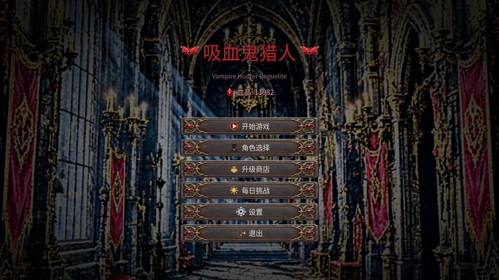
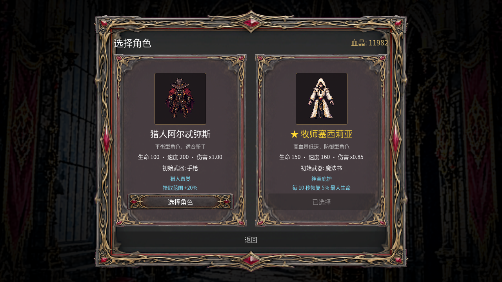
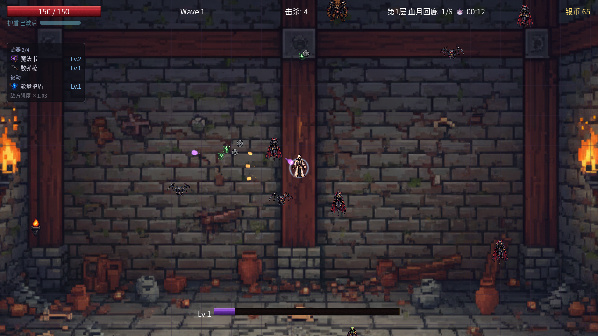
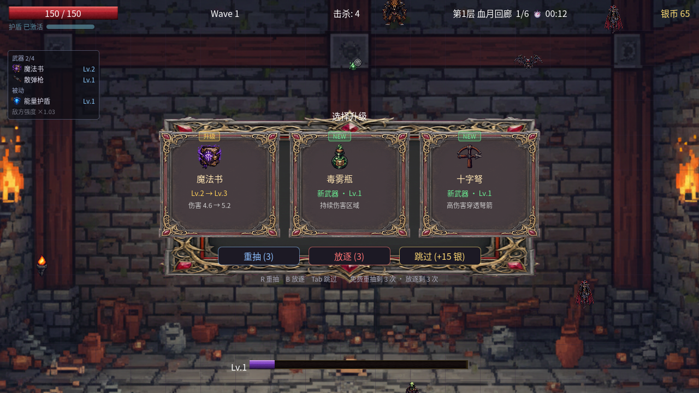
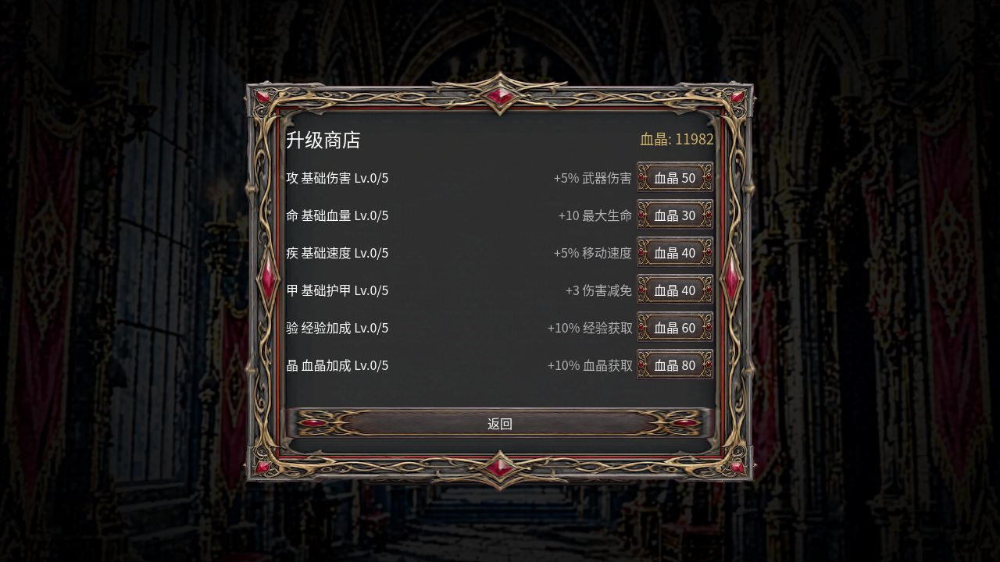
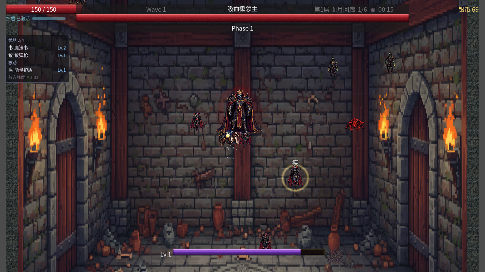

# 吸血鬼猎人 · Vampire Hunter Roguelite

[](https://godotengine.org)
[](LICENSE)

2D 哥特风 Roguelite 射击。WASD 走位、鼠标瞄准、武器自动开火，三层地下城一路杀到血族女王。

宣传站：<https://wjt0321.github.io/Vampire-Hunter-Roguelite/>（源文件在 `site/`，推到 `master` 后由 GitHub Actions 发布到 `gh-pages`）。

## 截图

| 主菜单 | 角色选择 |
|---|---|
|  |  |

| 战斗 | 升级三选一 |
|---|---|
|  |  |

| 商店 | Boss 战 |
|---|---|
|  |  |

## 核心循环

1. **清房**：每间战斗房刷 30 秒怪潮，清完开传送门。
2. **变强**：升级三选一（可重抽 / 放逐 / 跳过换银币）→ 攒武器与被动，满级武器可进化。
3. **消费**：局内银币在商店房买武器、被动、消耗品；休息房可选「安息回血」或「缔约换收益」。
4. **下潜**：每层最后一间是 Boss；通关拿血晶，在元进度界面买永久升级、解锁角色。

## 操作

| 按键 | 功能 |
|---|---|
| `W/A/S/D` | 移动 |
| `鼠标` | 控制非自动瞄准武器的方向 |
| `R` / `Tab` | 升级界面：重抽 / 跳过 |
| `B` | 升级界面：放逐（把选项移出本局选池） |
| `ESC` | 暂停 |

所有武器默认自动开火，无需按键。魔法书、飞刀等自动瞄准武器会锁定最近敌人；
手枪、散弹枪、火焰喷射器朝鼠标方向射击，角色朝向跟随鼠标。

`Space` 同时是面板上的 `ui_accept`，所以所有界面按钮都设成不可聚焦（`FOCUS_NONE`），
在任何面板上按 `Space` 都不会误触按钮。

## 运行

需要 [Godot 4.7+](https://godotengine.org/download)。导入 `project.godot`，按 `F5`。

Windows 也可直接双击 `RunGame.bat`（自动在常见路径下找 Godot，或把 `Godot.exe` 拖到脚本上）。

## 内容一览

| 模块 | 数量 | 说明 |
|---|---|---|
| 地下城 | 3 层 × 6–7 房 | 20 间房、12 个战斗波次，4 套主题环境 |
| 武器 | 11 把 | 手枪 / 散弹枪 / 魔法书 / 飞刀 / 苦无 / 毒雾瓶 / 闪电法杖 / 十字弩 / 圣光魔杖 / 火焰喷射器 / 血爆；可叠级，满级可进化，最多同时携带 4 把 |
| 被动道具 | 11 种 | 吸血、闪避、暴击、护盾、回血、移速等 |
| 属性卡 | 6 种 | 伤害 / 攻速 / 移速 / 生命 / 护甲 / 拾取范围 |
| 敌人 | 11 种 + 3 Boss | 另有四类精英词缀（血盾 / 冲锋 / 裂变 / 急速）随机附着在普通敌人身上 |
| 元进度 | 6 项 × 5 级 | 血晶购买永久伤害、生命、移速、护甲、经验、血晶加成 |
| 角色 | 2 名 | 猎人阿尔忒弥斯（平衡）/ 牧师塞西莉亚（防御），各自独立待机/奔跑/攻击/受击/死亡/护盾精灵 |

## 美术

全部 350+ 张贴图（角色、敌人、武器、道具、特效、UI 边框、场景材质）为 AI 生成 +
程序化后处理的原创资产，不含第三方版权素材；主菜单图标、特效构图参考等由
PIL 脚本绘制。生成与替换管线保留在 `.workbuddy/comfy/`，来源与许可说明见
`docs/asset-licenses.md`、`docs/asset-source-list.md`。

角色、敌人与 Boss 都有多帧横条（56px / 128px 单格），旧敌人与迭代新增敌人
各有专属动作条；11 条特效与 5 个环境道具是序列帧。动态帧的完整清单见
[`docs/animation-asset-inventory.md`](docs/animation-asset-inventory.md)。

## 项目结构

```
scenes/          # 主场景、玩家、敌人、UI
scripts/
  core/          # GameConfig（全部数值）、ItemCatalog（武器/被动单一数据源）、
                 # ProjectileVisuals（程序化贴图）、ObjectPool
  managers/      # main / wave_manager / dungeon_manager / vfx_manager /
                 # texture_manager / 存档与音频
  player/        # 玩家、经验宝石、银币、临时增益
  enemies/       # 敌人基类、各敌人行为、精英词缀
  weapons/       # 武器基类、武器管理器、进化
  ui/            # HUD、升级三选一、商店、血之祭坛、UI 动效
tools/           # 无头测试套件与数值验算脚本（见下）
docs/            # GDD、路线图、资产清单、动态帧台账、归档文档、README 截图
```

## 开发与自测

所有数值集中在 `scripts/core/game_config.gd`，改数值先跑验算工具。

```bash
GODOT=/path/to/Godot_v4.x-stable_win64_console.exe

# 曲线与房间结构验算（打印 TTK 表，不玩游戏）
"$GODOT" --headless --path . --script res://tools/balance_report.gd
"$GODOT" --headless --path . --script res://tools/dungeon_test.gd

# 断言套件（每个都会打印通过/失败计数，失败返回非 0）
"$GODOT" --headless --path . --script res://tools/xp_gem_test.gd
"$GODOT" --headless --path . --script res://tools/elite_affix_test.gd
"$GODOT" --headless --path . --script res://tools/balance_curve_test.gd

# 三层全流程冒烟
"$GODOT" --headless --path . --script res://tools/run_dungeon_smoke.gd
```

重录 README 截图（需要带窗口运行，不能加 `--headless`）：

```bash
"$GODOT" --path . --script res://tools/readme_shots.gd
```

设计文档：`docs/GDD.md`（含各系统的取舍说明）、`docs/ROADMAP.md`（进度）、
`docs/reference-deconstruction.md`（开源竞品拆解）。

## 许可

MIT，见 [LICENSE](LICENSE)。美术资源来源见 `docs/asset-licenses.md`。
